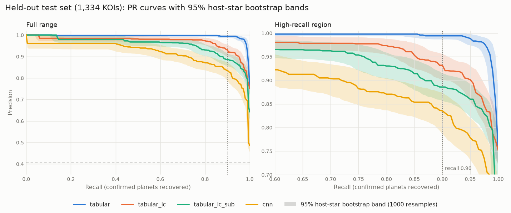
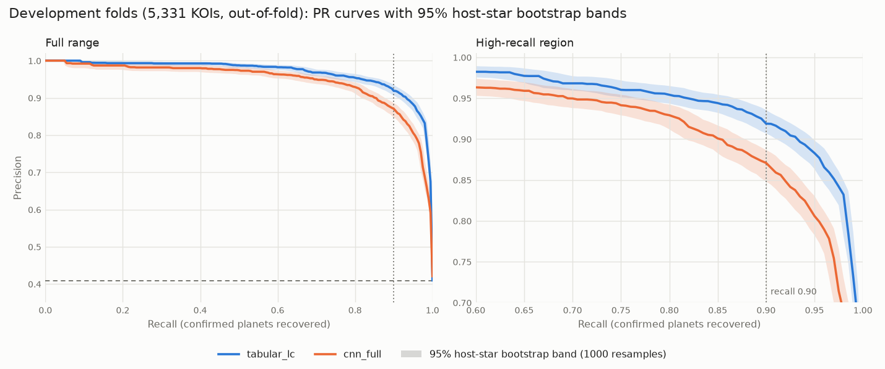

# Evaluation Protocol

`scripts/evaluate.py` compares models by precision-recall and analyses their errors.
Code: `exoplanet.evaluation` (`pr`, `false_positives`, `plots`, `metrics`).

## Protocol

- **Two modes.** `--split dev` evaluates out-of-fold scores from the development folds and
  can be run at any time. `--split test` scores the held-out test set with the final models
  (refit on all development KOIs). The test set is scored once, after all modelling
  decisions are made; the script refuses to overwrite test results without `--force`.
- **Same KOIs for every model.** Models are compared on the intersection of the KOIs they
  can score (the CNN lacks KOIs whose light curves could not be built); the report states
  the coverage.
- **Uncertainty.** PR-AUC 95% intervals come from 1,000 cluster-bootstrap resamples of host
  stars, because KOIs on one star are correlated. Model differences are paired: both models
  are scored on the same resampled stars.
- **Operating point.** Each model's threshold is the lowest score reaching precision 0.95 on
  the development out-of-fold scores, maximising recall there; it is applied unchanged to
  the test set.
- **False-positive analysis.** For each Robovetter flag (not transit-like, stellar eclipse,
  centroid offset, ephemeris match), the share of false positives scored below threshold.
  Flags are vetting outputs and never model inputs; KOIs can carry several. Recall on
  confirmed planets is broken down by SNR and period quartiles, and each model's most
  confident mistakes are listed.

Models compared (`evaluation.models` in the config):

- `tabular`: gradient boosting on transit + stellar + centroid catalogue features;
- `tabular_lc`: transit + stellar only, since the light-curve CNN sees no centroid data;
- `tabular_lc_sub`: as `tabular_lc`, trained only on the development KOIs that have
  light-curve views. The capped view build leaves the CNN ~21% of the development KOIs, so
  this control separates "light curve vs catalogue" from "less training data";
- `cnn`: the two-tower CNN on global and local views.

All four were final, with thresholds fixed from development scores, before the test set was
scored. The test evaluation was run once (a first attempt crashed while loading the CNN
checkpoint, before any test score was computed or saved).

## Results

Full generated tables: [results.md](results.md). Test set: 1,334 of 1,335 KOIs (one star had
no usable light curve).

| model | dev PR-AUC (95% CI) | test PR-AUC (95% CI) | test recall / precision at dev threshold |
|---|---|---|---|
| tabular | 0.994 (0.989-0.997) | 0.993 (0.984-0.998) | 0.984 / 0.962 |
| tabular_lc | 0.960 (0.946-0.973) | 0.966 (0.947-0.982) | 0.734 / 0.978 |
| tabular_lc_sub | 0.931 (0.905-0.951) | 0.953 (0.935-0.969) | 0.394 / 0.977 |
| cnn | 0.917 (0.888-0.942) | 0.903 (0.870-0.934) | 0.518 / 0.937 |

Development figures are on the 1,123 development KOIs with views (the only ones every model
can score), so they differ slightly from the tabular-only numbers in
[tabular_baseline.md](tabular_baseline.md).

### Findings

1. **Centroid diagnostics dominate.** The full tabular model is best everywhere (test
   PR-AUC 0.993; recall 0.98 at precision 0.96). Removing centroid features costs 0.028
   PR-AUC (95% CI 0.012-0.046) and a quarter of the recall at the operating point.
2. **The CNN is behind a tabular model trained on the same data.** On the test set the CNN
   trails `tabular_lc_sub` by 0.051 PR-AUC (95% CI 0.023-0.079). On the smaller development
   comparison the gap (0.014, CI -0.013 to 0.042) was not significant; the test set is
   larger and is the definitive measurement.
3. **Training-set size matters, but explains only part of the gap.** Training the transit +
   stellar model on the CNN's 21% subset costs 0.013 test PR-AUC (CI 0.001-0.025). Most of
   the CNN's deficit relative to `tabular_lc` (0.063) remains after matching data.
4. **Missing transit depth explains only a few CNN errors.** Each view is normalised so
   the transit minimum is -1, as in AstroNet, so the CNN cannot see absolute depth. Its two
   most confident test false positives are giant-radius eclipsing binaries (K03873.01 and
   K04939.01, 54 and 57 Earth radii) that every tabular model scores below 0.08. But they
   are a minority: only 4 of the 19 test false positives the CNN accepts have radii above
   20 Earth radii, and the median accepted depth is ~1,300 ppm. Ten of the 19 carry the
   centroid-offset flag, i.e. contamination from a nearby star that photometry alone cannot
   reveal. A follow-up that gave the CNN depth explicitly gained little (see below). An
   earlier version of this note called missing depth the most likely main cause; the
   follow-up does not support that.
5. **Where the CNN helps.** At the dev-chosen thresholds the CNN recovers more planets than
   `tabular_lc_sub` (0.52 vs 0.39 recall) at somewhat lower precision (0.94 vs 0.98), with
   the largest gains for high-SNR planets (0.77 vs 0.40 in the top SNR quartile). Its
   threshold also transferred less well: test precision 0.937 against the 0.95 target.
6. **Hard cases for every light-curve-only model** are low-SNR and short-period planets
   (CNN recall 0.20 and 0.24 in the lowest quartiles; `tabular_lc` 0.53 and 0.62).
   Several of the CNN's most confidently missed planets belong to multi-planet systems
   (K00904.02, K00904.03, K00282.03); one possible cause, not verified here, is sibling
   planets' transits left in the folded light curve.

## What a high score means

The models reproduce a **vetting judgement**: a score near 1 means the signal resembles KOIs
that the Kepler team and follow-up programmes confirmed. It is not a planet detection.
Confirming a planet requires follow-up observation (radial velocities, high-resolution
imaging or statistical validation), and every "planet found" below means "KOI the model
would send to follow-up".

## Success criteria

The brief asks for PR-AUC >= 0.80 after the leakage audit, with recall >= 0.90 at a stated
precision. Both are measured on the audited models; recall-0.90 thresholds are chosen on
development out-of-fold scores and applied unchanged to the saved test scores
(`python scripts/operating_points.py`; `outputs/operating_points.md`).

| Model | Test PR-AUC (95% CI) | Precision at recall 0.90, dev threshold on test | Meets both |
|---|---|---|---|
| `tabular` | 0.993 (0.984-0.998) | 0.994 (recall 0.916) | yes |
| `tabular_lc` | 0.966 (0.947-0.982) | 0.932 (recall 0.901) | yes |
| `cnn` (21% of dev KOIs) | 0.903 (0.870-0.934) | 0.848 (recall 0.881) | PR-AUC yes; recall fell just short on test |
| `cnn_full` (dev only) | dev 0.946 (0.937-0.954) | dev 0.871 at recall 0.900 | yes on dev; not test-scored |

A threshold chosen on development scores lands near, not exactly on, recall 0.90 when
applied to the test set; the recall achieved is shown in brackets. It is also slightly
sensitive to which development KOIs it is set on: set on all 5,342 development KOIs instead
of the 5,331 shared with `cnn_full`, `tabular_lc` reaches test recall 0.896 at precision
0.931.

Shaded bands are 95% host-star bootstrap intervals of the interpolated precision at each
recall (1,000 resamples; `python scripts/plot_pr_bands.py`). In the high-recall region the
CNN's band sits clearly below the tabular models', while `tabular_lc` and `tabular_lc_sub`
overlap.

## Operating point and follow-up cost

Telescope time for follow-up is the scarce resource: every false positive sent on costs a
campaign that finds nothing, and every planet held back is a planet not confirmed. The table
expresses each candidate threshold in those terms, on the 5,331 development KOIs every model
scores (thresholds chosen there).

| Model | Operating point | Planets sent on | Planets held back | Wasted follow-ups | Follow-ups per planet |
|---|---|---|---|---|---|
| `tabular` | precision 0.95 | 2,135 | 44 | 112 | 1.05 |
| `tabular` | recall 0.90 | 1,962 | 217 | 28 | 1.01 |
| `tabular_lc` | precision 0.95 | 1,782 | 397 | 93 | 1.05 |
| `tabular_lc` | recall 0.90 | 1,962 | 217 | 174 | 1.09 |
| `cnn_full` | precision 0.95 | 1,512 | 667 | 79 | 1.05 |
| `cnn_full` | recall 0.90 | 1,962 | 217 | 291 | 1.15 |

**Chosen operating point: precision 0.95**, i.e. at most one wasted follow-up for every 19
planets confirmed (1.05 targets observed per planet). Reasons:

- Follow-up is far more expensive than vetting: a radial-velocity confirmation can take
  many nights on a large telescope, so the false-positive rate, not the number of candidates,
  limits how many planets a programme confirms.
- Precision 0.95 keeps that waste fixed across models, so models are compared on how many
  planets they let through at the same cost.
- A survey that must not miss planets would choose recall 0.90 instead (the brief's
  success criterion); the table gives its cost. For `tabular_lc` it adds 180 planets and
  81 wasted follow-ups; for `cnn_full`, 450 planets and 212 wasted follow-ups.

Thresholds are always set on development scores. On the test set, precision at the dev
threshold was 0.962 (`tabular`), 0.978 (`tabular_lc`) and 0.937 (`cnn`) against the 0.95
target.

## Class weighting

False positives outnumber planets (59% vs 41% in the modelling sample). Both model types
can weight classes identically: `--class-weight balanced` sets scikit-learn's
`class_weight="balanced"` for gradient boosting (weights n / (2 n_class)) and the same
relative weight, `pos_weight` = n_negative / n_positive, in the CNN's loss
(`exoplanet.models.cnn.positive_weight`). Weighted models were trained on the same folds
and compared on development out-of-fold scores (`--tag weighted`, `--tag weighted_tab`):

| Model | Unweighted dev PR-AUC | Balanced dev PR-AUC | Difference (95% CI) |
|---|---|---|---|
| `tabular` | 0.994 | 0.994 | -0.000 (-0.000 to 0.000), p = 0.39 |
| `tabular_lc` | 0.969 | 0.967 | -0.002 (-0.003 to 0.000), p = 0.02 |
| `cnn_full` | 0.946 | 0.935 | -0.011 (-0.017 to -0.005), p < 0.001 |

- **Weighting does not help.** The imbalance is mild, and the operating threshold is chosen
  separately on development scores, which already compensates for any shift in score
  calibration. PR-AUC is a ranking metric, so reweighting can only change it by changing
  what the model learns.
- **The CNN gets slightly worse** with weighting, though this is a single training run per
  setting; seed-to-seed variation is not captured by the star bootstrap.
- **Decision:** all reported models are unweighted, identically for both model types, with
  class balance handled by the precision-recall evaluation and the dev-chosen threshold. The
  weighted variants (`tabular_w`, `tabular_lc_w`, `cnn_full_w`) remain reproducible with
  `--class-weight balanced`.

## Follow-up experiments (development folds only)

The test set has been used, so later experiments are judged on the development folds only
(`python scripts/evaluate.py --split dev --tag <name>`). The depth and odd/even experiments
use the 1,123 KOIs that had views at the time; the full-development CNN uses all of them.

### Transit depth as an input (`cnn_depth`)

The CNN plus three log-scaled scalars, `koi_depth`, `koi_period` and `koi_duration`, joined
to its dense head (`python scripts/train_cnn.py --name cnn_depth --scalars koi_depth
koi_period koi_duration`). Period and duration are already used to fold the views, so the new
information is depth. Control `tabular_scalars_sub`: gradient boosting on those three
features alone, trained on the same KOIs.

| model | dev PR-AUC (95% CI) |
|---|---|
| tabular_lc_sub | 0.931 (0.905-0.951) |
| cnn_depth | 0.926 (0.900-0.948) |
| cnn | 0.917 (0.888-0.942) |
| tabular_scalars_sub | 0.795 (0.751-0.841) |

- Depth adds +0.009 PR-AUC to the CNN (95% CI 0.000-0.018, p = 0.048): a marginal gain, not
  a fix.
- It does not reduce deep false positives: the CNN already accepts few of them (1 of 336
  development false positives with radii above 20 Earth radii; 3 with depth as an input).
- The three scalars alone are far weaker (0.795), so the views carry most of the CNN's
  information.

### Odd/even and secondary-eclipse views (`cnn_oe`)

Three extra views on the local grid: the local view of odd-numbered transits, of
even-numbered transits, and a view centred at phase 0.5 (secondary eclipse for a circular
orbit). They are scaled with the primary local view's normalisation, so a binary's unequal
odd/even depths or its secondary eclipse keep their relative depth instead of each being
normalised to -1. The four local-grid views enter the CNN's local tower as channels
(`python scripts/train_cnn.py --name cnn_oe --local-views local_view odd_view even_view
secondary_view`). Global and local views were rebuilt bit-identically, so earlier models'
results stand.

| model | dev PR-AUC (95% CI) | recall at precision 0.95 |
|---|---|---|
| tabular_lc_sub | 0.931 (0.905-0.951) | 0.421 |
| cnn_depth | 0.926 (0.900-0.948) | 0.572 |
| cnn | 0.917 (0.888-0.942) | 0.364 |
| cnn_oe | 0.909 (0.874-0.938) | 0.501 |

- **No improvement in ranking:** `cnn` - `cnn_oe` = 0.008 PR-AUC (95% CI -0.009 to 0.027,
  p = 0.39).
- **The targeted false positives were already handled.** The plain CNN accepts only 3 of 365
  stellar-eclipse false positives at its operating threshold; `cnn_oe` accepts 2. On real
  data the views do show the intended signatures (e.g. a secondary eclipse at -0.3 for the
  eclipsing binary K07278.01; matching odd/even and a flat secondary for the planet
  K00723.01), but the CNN could already reject these cases.
- **The CNN's main weakness is missed planets**, especially at low SNR and short period, and
  these views are false-positive diagnostics; they do not make faint transits easier to see.
- Recall at precision 0.95 rose (0.36 to 0.50, and 0.57 for `cnn_depth`), but each threshold
  is chosen on the same development scores it is measured on, and at 95% precision recall
  swings with small changes among the top-ranked KOIs. The threshold-free PR-AUC shows no
  difference, so this is not evidence of a real gain.
- Known limitation: for very short-period variables such as the 1.75-day contact binary
  K01957.02, the views show flat plateaus at the brightest phases. Upward-outlier clipping
  (meant for flares) appears to remove genuine variability there. It predates these views,
  affects only extreme variables (false positives either way) and has not been changed.

### CNN trained on the full development set (`cnn_full`)

Views were built for the remaining development stars (`python scripts/build_views.py`),
giving views for 6,665 of 6,677 KOIs (99.8%; `outputs/views_summary.md`). Ten stars failed
and were not retried: KIC 10462462 (no usable data after detrending) and nine whose MAST
downloads hit the 600 s timeout during a server slowdown (`outputs/views_failures.csv`).
The CNN was then retrained unchanged, same architecture and hyperparameters, on the same
host-star folds (`python scripts/train_cnn.py --name cnn_full`), on a GPU (RTX 2050,
3 min 23 s for five folds plus the final model). GPU runs are seeded but not bit-identical
to CPU runs.

On all 5,331 development KOIs that both models can score (`--tag full`):

| model | dev PR-AUC (95% CI) | recall at precision 0.95 |
|---|---|---|
| tabular_lc | 0.969 (0.962-0.974) | 0.818 |
| cnn_full | 0.946 (0.937-0.954) | 0.694 |

`tabular_lc` - `cnn_full` = 0.023 PR-AUC (95% CI 0.014-0.031, p < 0.001).

On the 1,123 KOIs used by the earlier experiments (`--tag full_sub`), where the old CNN can
also be scored:

| model | dev PR-AUC (95% CI) | recall at precision 0.95 |
|---|---|---|
| tabular_lc | 0.960 (0.946-0.973) | 0.741 |
| cnn_full | 0.949 (0.929-0.965) | 0.719 |
| tabular_lc_sub | 0.931 (0.905-0.951) | 0.421 |
| cnn | 0.917 (0.888-0.942) | 0.364 |

- **More training data is the first change that clearly helps the CNN:** `cnn_full` -
  `cnn` = +0.031 PR-AUC on the same KOIs (95% CI 0.016-0.050, p < 0.001), against +0.009
  for depth and -0.008 for the odd/even views. It is now level with the full tabular model on
  these KOIs (`tabular_lc` - `cnn_full` = 0.012, 95% CI -0.006 to 0.029, p = 0.20).
- **Recall at precision 0.95 roughly doubles** (0.364 to 0.719 on the same KOIs), and the
  gain is spread across all SNR and period bins, e.g. 0.173 to 0.482 at the lowest SNR and
  0.145 to 0.518 at the shortest periods. Unlike the earlier recall changes, this one comes
  with a clear PR-AUC gain.
- **Faint planets remain the CNN's main weakness.** On all development KOIs it recovers 41%
  of confirmed planets in the lowest SNR quartile (SNR 5.9-19.2), against 67% for
  `tabular_lc`, and 48% against 66% at the shortest periods (< 5 days). Across the full set
  the tabular model still leads at every SNR and period bin.
- **It still rejects false positives as well as the tabular model:** 97.5% of development
  false positives fall below its operating threshold (97.0% for `tabular_lc`), including
  99.1% of stellar-eclipse and 96.4% of centroid-offset cases.
- Fold-to-fold spread is large: folds 0, 3 and 4 reach 0.955-0.967 PR-AUC, folds 1 and 2
  about 0.915. Validation PR-AUC plateaus from about epoch 15 (`outputs/cnn_full_cv.md`), so
  more epochs at this learning rate are unlikely to help.
- `cnn_full` has not been scored on the test set; the test results in `docs/results.md` are
  for `cnn`.

### Most promising next steps

- Combine `cnn_full` with the tabular model (e.g. its out-of-fold score as a tabular
  feature, or an average of the two): they now score similarly but use different inputs.
- Recover more low-SNR and short-period planets, where every light-curve-only model is
  weakest; one candidate is removing sibling planets' transits before folding.
- Centroid-offset false positives need pixel-level information (centroid or difference-image
  data); photometry alone cannot separate them.
