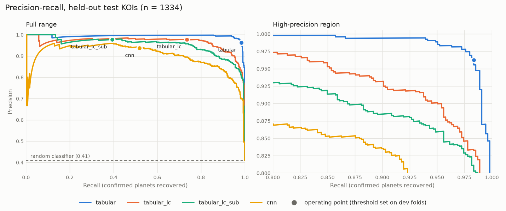

# Results

Generated by `scripts/make_report.py` from pipeline outputs; do not edit by hand. Methodology: [evaluation.md](evaluation.md), [lightcurve_pipeline.md](lightcurve_pipeline.md), [tabular_baseline.md](tabular_baseline.md).

Models:

- `tabular`: gradient boosting, transit + stellar + centroid catalogue features
- `tabular_lc`: gradient boosting, transit + stellar features (no centroid data, like the CNN)
- `tabular_lc_sub`: as tabular_lc, trained only on KOIs with light-curve views (the CNN's training data)
- `cnn`: two-tower 1D CNN on global and local light-curve views

## Data

Modelling sample: 6677 labelled KOIs (CONFIRMED = 1, FALSE POSITIVE = 0) on 5830 host stars, DR25 parameters only. The test set and the 5 development folds are grouped by host star and stratified by label.

| partition | kois | stars | positive_fraction |
|---|---|---|---|
| development | 5342 | 4670 | 0.409 |
| test | 1335 | 1160 | 0.409 |

## Light-curve coverage

2457 of 6677 KOIs (36.8%) have light-curve views.

| partition | kois | with_views |
|---|---|---|
| development, label 0 | 3157 | 0.217 |
| development, label 1 | 2185 | 0.200 |
| test, label 0 | 789 | 0.999 |
| test, label 1 | 546 | 1.000 |

1 host stars failed in the last build run.

## Cross-validation (development folds)

Out-of-fold scores; each model is scored on the development KOIs it has inputs for (see the evaluation sections for a same-KOI comparison).

| model | kois | pooled_pr_auc | fold_pr_auc_mean | fold_pr_auc_std | fold_roc_auc_mean |
|---|---|---|---|---|---|
| tabular | 5342 | 0.994 | 0.994 | 0.002 | 0.996 |
| tabular_lc | 5342 | 0.969 | 0.969 | 0.008 | 0.980 |
| tabular_lc_sub | 1123 | 0.931 | 0.937 | 0.039 | 0.963 |
| cnn | 1123 | 0.917 | 0.924 | 0.015 | 0.954 |

## Evaluation: development folds

1123 KOIs scored by every model (21.0% of 5342); positive fraction 0.389. PR-AUC with 95% host-star bootstrap intervals (1000 resamples); operating threshold set for precision 0.95 on development out-of-fold scores.

| model | pr_auc | ci_low | ci_high | at_threshold_precision | at_threshold_recall | at_threshold_fp | at_threshold_fn |
|---|---|---|---|---|---|---|---|
| tabular | 0.994 | 0.989 | 0.997 | 0.951 | 0.986 | 22 | 6 |
| tabular_lc | 0.960 | 0.946 | 0.973 | 0.950 | 0.741 | 17 | 113 |
| tabular_lc_sub | 0.931 | 0.905 | 0.951 | 0.953 | 0.421 | 9 | 253 |
| cnn | 0.917 | 0.888 | 0.942 | 0.952 | 0.364 | 8 | 278 |

Paired PR-AUC differences:

| comparison | difference | ci_low | ci_high | p_value |
|---|---|---|---|---|
| tabular - tabular_lc | 0.034 | 0.022 | 0.047 | 0.000 |
| tabular - tabular_lc_sub | 0.063 | 0.043 | 0.087 | 0.000 |
| tabular - cnn | 0.077 | 0.053 | 0.106 | 0.000 |
| tabular_lc - tabular_lc_sub | 0.030 | 0.016 | 0.045 | 0.000 |
| tabular_lc - cnn | 0.043 | 0.019 | 0.070 | 0.000 |
| tabular_lc_sub - cnn | 0.014 | -0.013 | 0.042 | 0.350 |

False positives rejected at the operating threshold, by Robovetter flag:

| flag | n | tabular | tabular_lc | tabular_lc_sub | cnn |
|---|---|---|---|---|---|
| all false positives | 686 | 0.968 | 0.975 | 0.987 | 0.988 |
| not transit-like | 149 | 0.980 | 0.993 | 1.000 | 1.000 |
| stellar eclipse | 365 | 0.970 | 0.981 | 1.000 | 0.992 |
| centroid offset | 329 | 0.982 | 0.960 | 0.979 | 0.988 |
| ephemeris match | 187 | 0.979 | 0.947 | 0.973 | 0.995 |

Full report: `outputs/evaluation_dev.md`.

## Evaluation: held-out test set

1334 KOIs scored by every model (99.9% of 1335); positive fraction 0.409. PR-AUC with 95% host-star bootstrap intervals (1000 resamples); operating threshold set for precision 0.95 on development out-of-fold scores.

| model | pr_auc | ci_low | ci_high | at_threshold_precision | at_threshold_recall | at_threshold_fp | at_threshold_fn |
|---|---|---|---|---|---|---|---|
| tabular | 0.993 | 0.984 | 0.998 | 0.962 | 0.984 | 21 | 9 |
| tabular_lc | 0.966 | 0.947 | 0.982 | 0.978 | 0.734 | 9 | 145 |
| tabular_lc_sub | 0.953 | 0.935 | 0.969 | 0.977 | 0.394 | 5 | 331 |
| cnn | 0.903 | 0.870 | 0.934 | 0.937 | 0.518 | 19 | 263 |

Paired PR-AUC differences:

| comparison | difference | ci_low | ci_high | p_value |
|---|---|---|---|---|
| tabular - tabular_lc | 0.028 | 0.012 | 0.046 | 0.000 |
| tabular - tabular_lc_sub | 0.040 | 0.026 | 0.056 | 0.000 |
| tabular - cnn | 0.091 | 0.063 | 0.121 | 0.000 |
| tabular_lc - tabular_lc_sub | 0.013 | 0.001 | 0.025 | 0.014 |
| tabular_lc - cnn | 0.063 | 0.035 | 0.094 | 0.000 |
| tabular_lc_sub - cnn | 0.051 | 0.023 | 0.079 | 0.000 |

False positives rejected at the operating threshold, by Robovetter flag:

| flag | n | tabular | tabular_lc | tabular_lc_sub | cnn |
|---|---|---|---|---|---|
| all false positives | 788 | 0.973 | 0.989 | 0.994 | 0.976 |
| not transit-like | 175 | 0.966 | 0.994 | 1.000 | 0.983 |
| stellar eclipse | 425 | 0.969 | 0.995 | 0.995 | 0.981 |
| centroid offset | 356 | 0.994 | 0.980 | 0.989 | 0.972 |
| ephemeris match | 209 | 0.995 | 1.000 | 0.995 | 0.990 |

Full report: `outputs/evaluation_test.md`.

## Provenance

- Generated: 2026-10-31T14:12:12+00:00 from commit `3352466 (uncommitted changes)`; config `default.yaml` (SHA-256 `2b037c103631…`)
- KOI catalogue: NASA Exoplanet Archive cumulative table, retrieved 2026-10-31T03:14:15+00:00, 9564 rows, SHA-256 `a85348f20082…`
