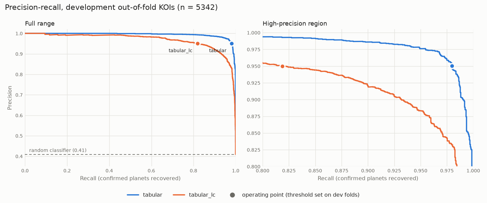

# Results

Generated by `scripts/make_report.py` from pipeline outputs; do not edit by hand. Methodology: [evaluation.md](evaluation.md), [lightcurve_pipeline.md](lightcurve_pipeline.md), [tabular_baseline.md](tabular_baseline.md).

Models:

- `tabular`: gradient boosting, transit + stellar + centroid catalogue features
- `tabular_lc`: gradient boosting, transit + stellar features (no centroid data, like the CNN)
- `cnn`: two-tower 1D CNN on global and local light-curve views

## Data

Modelling sample: 6677 labelled KOIs (CONFIRMED = 1, FALSE POSITIVE = 0) on 5830 host stars, DR25 parameters only. The test set and the 5 development folds are grouped by host star and stratified by label.

| partition | kois | stars | positive_fraction |
|---|---|---|---|
| development | 5342 | 4670 | 0.409 |
| test | 1335 | 1160 | 0.409 |

## Light-curve coverage

134 of 6677 KOIs (2.0%) have light-curve views.

| partition | kois | with_views |
|---|---|---|
| development, label 0 | 3157 | 0.023 |
| development, label 1 | 2185 | 0.014 |
| test, label 0 | 789 | 0.028 |
| test, label 1 | 546 | 0.013 |

## Cross-validation (development folds)

_Pending: `cnn` not trained. Run `python scripts/train_cnn.py`._

Out-of-fold scores; each model is scored on the development KOIs it has inputs for (see the evaluation sections for a same-KOI comparison).

| model | kois | pooled_pr_auc | fold_pr_auc_mean | fold_pr_auc_std | fold_roc_auc_mean |
|---|---|---|---|---|---|
| tabular | 5342 | 0.994 | 0.994 | 0.002 | 0.996 |
| tabular_lc | 5342 | 0.969 | 0.969 | 0.008 | 0.980 |

## Evaluation: development folds

_Incomplete: evaluated ['tabular', 'tabular_lc'], not ['cnn']. Re-run `python scripts/evaluate.py --split dev` once they are trained._

5342 KOIs scored by every model (100.0% of 5342); positive fraction 0.409. PR-AUC with 95% host-star bootstrap intervals (1000 resamples); operating threshold set for precision 0.95 on development out-of-fold scores.

| model | pr_auc | ci_low | ci_high | at_threshold_precision | at_threshold_recall | at_threshold_fp | at_threshold_fn |
|---|---|---|---|---|---|---|---|
| tabular | 0.994 | 0.992 | 0.995 | 0.950 | 0.980 | 112 | 44 |
| tabular_lc | 0.969 | 0.962 | 0.974 | 0.950 | 0.819 | 94 | 396 |

Paired PR-AUC differences:

| comparison | difference | ci_low | ci_high | p_value |
|---|---|---|---|---|
| tabular - tabular_lc | 0.025 | 0.020 | 0.031 | 0.000 |

False positives rejected at the operating threshold, by Robovetter flag:

| flag | n | tabular | tabular_lc |
|---|---|---|---|
| all false positives | 3157 | 0.965 | 0.970 |
| not transit-like | 692 | 0.974 | 0.991 |
| stellar eclipse | 1715 | 0.966 | 0.982 |
| centroid offset | 1423 | 0.982 | 0.946 |
| ephemeris match | 878 | 0.964 | 0.956 |

Full report: `outputs/evaluation_dev.md`.

## Evaluation: held-out test set

_Pending: held-out test set not evaluated. Run `python scripts/evaluate.py --split test`._

## Provenance

- Generated: 2026-10-31T11:24:47+00:00 from commit `5b8317f (uncommitted changes)`; config `default.yaml` (SHA-256 `b1a9e591940e…`)
- KOI catalogue: NASA Exoplanet Archive cumulative table, retrieved 2026-10-31T03:14:15+00:00, 9564 rows, SHA-256 `a85348f20082…`
